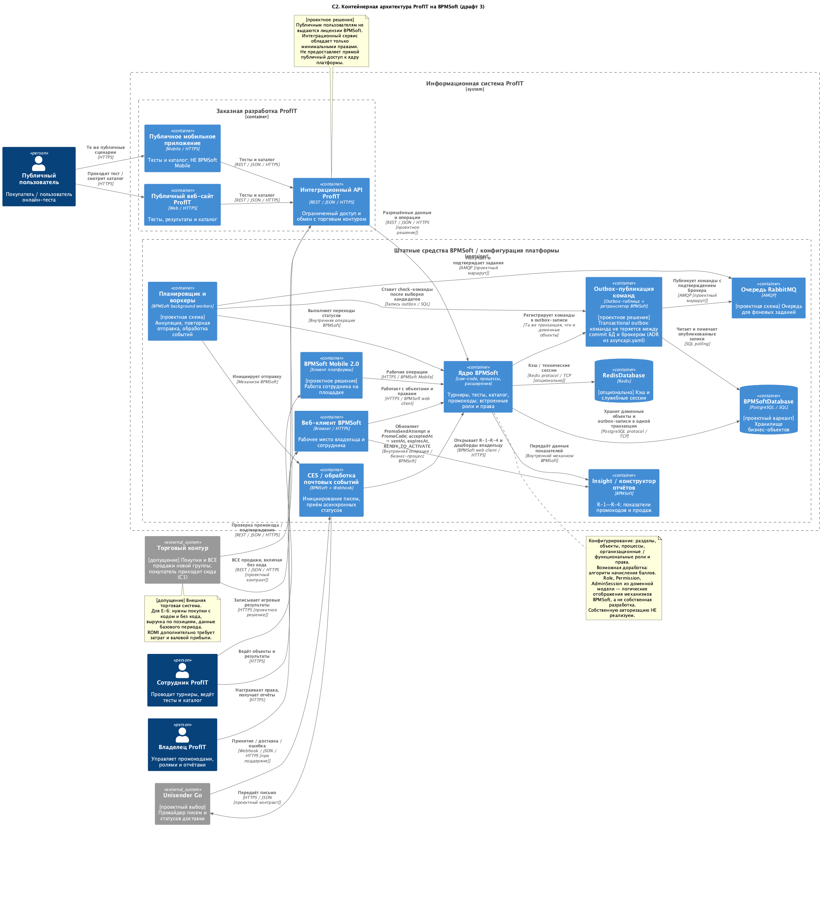

# ProfIT — продвижение настольных игр на BPMSoft

**ProfIT** — система продвижения товарной группы настольных игр и паззлов: офлайн-турниры, онлайн-тесты, выдача и жизненный цикл промокодов, публичный каталог, учёт покупок и аналитика продаж.

Система записи — **BPMSoft** (объекты, процессы, роли, Insight). Заказная часть — публичные web/mobile-клиенты и **тонкий Integration API**: наружу отдаются только операции, которых нет в штатном клиенте платформы или которые нужны внешним системам (магазин, почтовый провайдер).

В репозитории — интеграционные контракты, доменная и процессные модели, материалы реализации на учебном стенде BPMSoft и отчёты по практикам № 2–7.

[](./docs/validation_log.txt)
[](./docs/report/bpmn/)
[](./docs/report/bpmsoft/)
[](./docs/report/)

## Карта репозитория

| Папка | Что внутри |
|-------|------------|
| [`docs/`](./docs/) | Архитектура: разбор решений, C1/C2, лог валидации |
| [`docs/report/`](./docs/report/) | Отчёты практик № 2–7 (`.typ` + PDF), SVG-рендеры BPMN |
| [`docs/report/bpmn/`](./docs/report/bpmn/) | Исходники диаграмм `ProfIT_BPMN_00–10.bpmn`, скриншоты, журнал правок |
| [`docs/report/bpmsoft/`](./docs/report/bpmsoft/) | Рабочая тетрадь стенда: справочники → объекты → связи/UI → тесты |
| [`docs/report/domennaya/`](./docs/report/domennaya/) | Доменная модель MVP: 24 сущности, 12 перечислений, 32 связи (PlantUML + SVG) |
| [`docs/report/images/`](./docs/report/images/) | Скриншоты прогонов; в [`p6/`](./docs/report/images/p6/) — 44 снимка стенда |
| [`scripts/`](./scripts/) | Проверка контрактов: `check-specs.js`, `smoke-mock.js`, `run-evidence.sh` |
| [`scripts/bpmn/`](./scripts/bpmn/) | BPMN как код: `diagrams.mjs` → `build.mjs` → `check_files.mjs` → `render.mjs` |

Ключевые файлы в корне и `docs/`:

- [`openapi.yaml`](./openapi.yaml) — REST, OpenAPI 3.0.3; [`asyncapi.yaml`](./asyncapi.yaml) — команды/события брокера, AsyncAPI 3.0.0
- [`docs/ProfIT_API_design_analysis.md`](./docs/ProfIT_API_design_analysis.md) — архитектура, аудит черновика, реестры, трассировка
- [`docs/ProfIT_C1_context_fixed.puml`](./docs/ProfIT_C1_context_fixed.puml) / [`docs/ProfIT_C2_draft3.puml`](./docs/ProfIT_C2_draft3.puml) — контекст (C1) и контейнеры (C2)
- [`docs/validation_log.txt`](./docs/validation_log.txt) — последний прогон парсеров и smoke

Отчёты ([`docs/report/`](./docs/report/), Typst; PDF лежит рядом):

- [`2-pr.typ`](./docs/report/2-pr.typ) — практика № 2: доменная модель, инварианты I-01–I-44
- [`profit-api-practice4.typ`](./docs/report/profit-api-practice4.typ) — практика № 4: контракты и ревью
- [`profit-bpmn-practice5.typ`](./docs/report/profit-bpmn-practice5.typ) — практика № 5: процессы BPMN-00–10
- [`profit-objects-practice6.typ`](./docs/report/profit-objects-practice6.typ) — практика № 6: модель на стенде BPMSoft
- [`profit-raci-practice7.typ`](./docs/report/profit-raci-practice7.typ) — практика № 7: RACI и ролевая модель

**Разделы:** [Зачем два контракта](#зачем-два-контракта) · [Контуры API](#контуры-api) · [Статусы промокода](#статусы-промокода) · [Правила HTTP](#общие-правила-http) · [Проверка локально](#проверка-контрактов-локально) · [BPMN](#процессы-bpmn-20) · [Стенд BPMSoft](#модель-на-стенде-bpmsoft) · [Статус ревью](#статус-ревью)

Статус: спецификации прошли две проверки, комплект BPMN — одну; все замечания закрыты — см. раздел [«Статус ревью»](#статус-ревью).

## Зачем два контракта

Синхронный REST закрывает запросы «здесь и сейчас»: каталог, попытка теста, проверка промокода по корзине, подтверждение покупки, приём webhook’а почты.

Асинхронный контур закрывает то, что нельзя надёжно делать в одном HTTP-запросе: постановка письма в CES, повторная отправка, аннуляция по таймауту доставки или по истечению срока действия кода. Маршрут (проектная схема): ядро → outbox → очередь → воркеры → CES → провайдер; статусы письма возвращаются HTTP-webhook’ом и уже внутри платформы обновляют `PromoSendAttempt` / `PromoCode`.

## Контуры API

Базовый URL (условный): `/api/v1`. Среды в спецификации — `profit-dev` и `profit-test` (не production-адреса).

### `/public/*` — анонимный посетитель

- Опубликованный каталог (`Product`, `ProductGroup`), без служебных полей.
- Опубликованные тесты и неизменяемая версия с вопросами; признак `correct` у вариантов до финиша не отдаётся.
- Попытка теста без регистрации: при создании выдаётся `attemptToken`, дальше доступ только с `X-Attempt-Token` (`AttemptTokenAuth`).
- Сервер сам считает `score` / `successful`; клиент не подменяет правильность ответа.

### `/integrations/commerce/*` — торговый контур

Машинная аутентификация (`X-API-Key`, проектное решение).

- **validate** — применимость кода к многопозиционному заказу; цена из запроса не авторитетна, скидка считается по каталогу ProfIT.
- **purchases** — подтверждение покупки; активация промокода только отсюда (не из публичного API). Идемпотентность: `Idempotency-Key` + уникальный `purchaseExternalId`.
- **sales** — пакет всех продаж целевой группы, в том числе без промокода и baseline-период (для аналитики).

### `/integrations/mail/*` — провайдер почты

Webhook статусов (`ACCEPTED_BY_PROVIDER` / `DELIVERED` / `FAILED`). Это HTTP, не сообщение RabbitMQ. Подпись: `X-Provider-Signature` (+ timestamp против replay).

### Что намеренно не в REST

Турниры, черновики тестов, админ каталога, отмена промокода, роли/сессии сотрудников, отчёты R-1–R-4 — штатный веб-клиент BPMSoft и Insight. Отдельный «универсальный backend ProfIT» и своя система паролей не проектируются.

## Статусы промокода

**PromoCode:** `CREATED → READY_TO_ACTIVATE → ACTIVATED`, терминалы `CANCELLED`, `ANNULLED`.

**PromoSendAttempt:** `CREATED → ACCEPTED_BY_PROVIDER → DELIVERED | FAILED`.

Accept провайдера ≠ доставка. `sentAt` / переход в `READY_TO_ACTIVATE` — от первого допустимого accept до `deliveryDeadlineAt`. Отчёты по отправкам строятся по полям в БД (Insight), без обязательного отдельного event’а «письмо принято».

Подробнее — в анализе и в описаниях `openapi.yaml` / `asyncapi.yaml`.

## Общие правила HTTP

- Ошибки: `application/problem+json` (RFC 9457), `status` — число.
- Деньги: строка decimal, scale=2 (например `"1490.00"`); MVP-валюта — `RUB`.
- `X-Correlation-ID` — опционален на входе; если нет, сервер генерирует и отдаёт в ответе.
- `Idempotency-Key`: тот же ключ + то же тело → исходный успех; тот же ключ + другое тело → `409`.
- `503` — единообразно при недоступности ядра/зависимостей; на `429`/`503` смотреть `Retry-After`.

## Проверка контрактов локально

```bash
npm install
npm run evidence   
```

По шагам:

```bash
npm run check
npm run mock        # http://127.0.0.1:4010
npm run smoke       # другой терминал
```

Prism слушает пути **как в YAML** (`/public/...`), без префикса `/api/v1` из `servers`. Mock проверяет форму запросов/ответов и примеры; доменные правила BPMSoft он не исполняет.

Опционально: `npm run lint:openapi`.

## Процессы BPMN 2.0

Комплект из 11 редактируемых диаграмм — [`docs/report/bpmn/ProfIT_BPMN_00…10.bpmn`](./docs/report/bpmn/) (BPMN 2.0 XML + BPMNDI). Обзорная BPMN-00 собирает детальные процессы через Call Activity и показывает message flow к внешним участникам (пользователь, торговая система, почтовый провайдер, владелец, сотрудник); BPMN-01–10 покрывают бэклог E-1–E-7.

Стыки процессов — события-сообщения: основание GAME/TEST (01/03) → выдача промокода (05) → активация по покупке (06) → пакет продаж (08) → отчёты R-1–R-4 (10). Контроль сроков — плановой проверкой BPMN-07, а не таймером на каждый код — то же решение, что ADR в `asyncapi.yaml`.

Проверка комплекта:

```bash
node scripts/bpmn/check_files.mjs   # висячие ссылки, fan-out event-шлюзов, стрелки сквозь узлы
node scripts/bpmn/render.mjs        # SVG → docs/report/, PNG-превью → /tmp (bpmn-js + Chrome)
```

Генерация `.bpmn` из спецификаций `scripts/bpmn/diagrams.mjs`: `node scripts/bpmn/build.mjs --render`. Журнал исправлений по отзыву — [`docs/report/bpmn/Readme.md`](./docs/report/bpmn/Readme.md).

## Модель на стенде BPMSoft

Рабочая тетрадь [`docs/report/bpmsoft/`](./docs/report/bpmsoft/) — пошаговый перенос доменной модели на учебный стенд: 12 справочников (`01-lookups.md`), 24 объекта + связка `ChuRolePermission` колонка за колонкой (`02-objects.md`), связи/детали/разделы/рабочее место (`03-links-ui.md`), тестовые данные и чек-лист проверок (`04-testing-report.md`). Инварианты, которые lookup-ссылка не гарантирует (кратность 1:1, XOR, «тот же родитель»), помечены «требуется серверная проверка». Результат со скриншотами стенда — в отчёте практики № 6.

## Статус ревью

Контракты прошли две проверки. Все замечания закрыты — правки видны прямо в YAML и на C2-диаграмме; разбор каждого пункта с фрагментами контракта — в отчёте [`docs/report/profit-api-practice4.typ`](./docs/report/profit-api-practice4.typ) (PDF — рядом).

Комплект BPMN прошёл проверку драфта 1: таймер на промокод и двойная аннуляция убраны, добавлена обзорная BPMN-00, связи процессов выражены событиями-сообщениями, отчётность выделена в BPMN-10. Разбор каждого замечания — в [`docs/report/bpmn/Readme.md`](./docs/report/bpmn/Readme.md) и отчёте практики № 5.

### Драфт 3 — замечания второй проверки

| Замечание | Как закрыто |
|---|---|
| Очередь недоставленных сообщений объявлена, но не описана | Новый канал `promocodes.dlx` в `asyncapi.yaml`: direct-обменник + durable-очереди `*.dlq`; содержимое — исходные CloudEvent-конверты команд с `x-death`-заголовками; потребитель — операционная процедура разбора (мониторинг `*.dlq`, алерт, ручной/скриптовый повтор через ядро); автоматический воркер-потребитель DLQ сознательно не объявляется — защита от цикла «DLQ → повтор → DLQ» |
| Transactional outbox есть в контракте, но отсутствует в архитектуре | На C2 добавлен контейнер «Outbox-публикация команд» (outbox-таблица + ретранслятор BPMSoft): ядро и планировщик пишут outbox-записи в одной транзакции с доменными объектами, публикацию в RabbitMQ выполняет только ретранслятор с подтверждением брокера; прямой связи «ядро → брокер» больше нет |
| Аргументы очереди в нестандартном `additionalProperties` | Перенесены в штатное поле AMQP binding `queue.arguments` (аргументы `queue.declare`); у каждой очереди комментарий: значения для ручного/скриптового создания очередей, не для генерации кода |
| Мелкое: не указано семейство заголовков лимитов | Зафиксировано предполагаемое семейство IETF «RateLimit header fields for HTTP»: `RateLimit-Limit`, `RateLimit-Remaining`, `RateLimit-Reset` (+ `RateLimit-Policy` при нескольких политиках) — в `info.description` OpenAPI и в открытых вопросах отчёта, как фактура для согласования с заказчиком |

Контейнер outbox на обновлённой C2 (драфт 3):



### Драфт 2 — замечания первой проверки (закрыты ранее, поддерживаются)

| Замечание | Как закрыто |
|---|---|
| Отчёт не описывает `asyncapi.yaml` | Раздел «Асинхронная спецификация AsyncAPI» из шести подразделов в отчёте |
| Токен попытки не объявлен схемой безопасности при `401`/`403` | Схема `AttemptTokenAuth` (`apiKey`) у трёх операций попытки; header-параметр убран |
| Нет TTL сообщений и очереди недоставленных | `x-message-ttl`, `x-dead-letter-exchange`, `x-dead-letter-routing-key` у командных очередей; раздел о политике повторов |
| Ответ `429` без указания времени повтора | `Retry-After` + `X-Correlation-ID` в типовом ответе, пример тела ошибки; `Retry-After` также у `503` |
| Корреляция описана только на стороне ответа | Входящий `X-Correlation-ID` во всех 12 операциях; сквозная цепочка REST → конверт CloudEvents (`correlationid`) |
| Не описан смысл `409` при создании попытки | Код `TEST_ATTEMPT_IN_PROGRESS` в описании операции и типовом ответе `Conflict` |
| Проверены только позитивные ветки | Smoke из 14 шагов: 6 позитивных + 8 негативных, таблица статусов в отчёте |
| Версии инструментов и ревизия не зафиксированы | `docs/validation_log.txt`: Node.js, npm, Prism, `swagger-parser`, `@asyncapi/parser`, `git HEAD`, `write-tree` |
| Один сервер, нет правила вывода версии | `profit-dev` + `profit-test`; политика ломающих изменений и заголовок `Sunset` |
| Способ контроля сроков не зафиксирован как решение | ADR в `info.description` AsyncAPI с отклонённой альтернативой (per-code timer) |
| Нет взаимных ссылок между спецификациями | `externalDocs` в обоих документах (REST ↔ асинхронная спецификация) |

Скриншоты прогона Prism и smoke — [`docs/report/images/`](./docs/report/images/) (`image1.png` … `image2.1.png`), машинное доказательство — [`docs/validation_log.txt`](./docs/validation_log.txt) (`AsyncAPI OK: channels=6, ops=12`; smoke 14/14).
