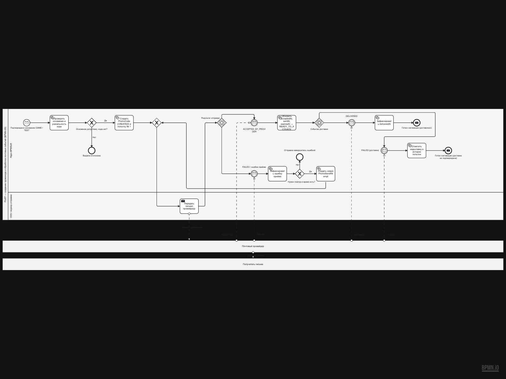
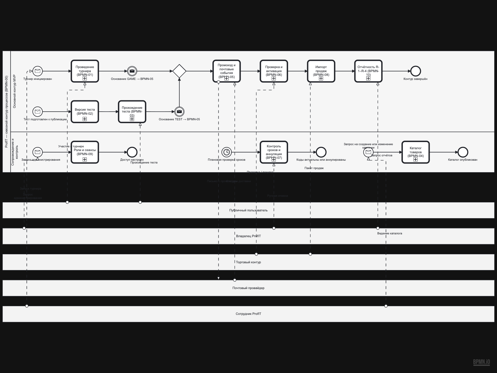
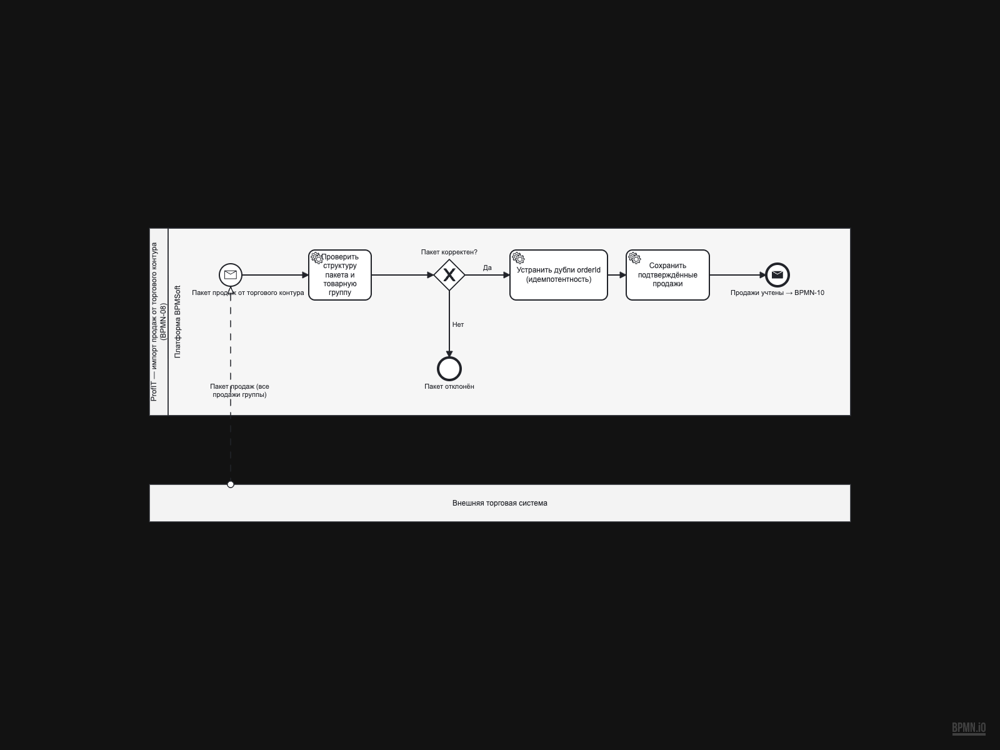
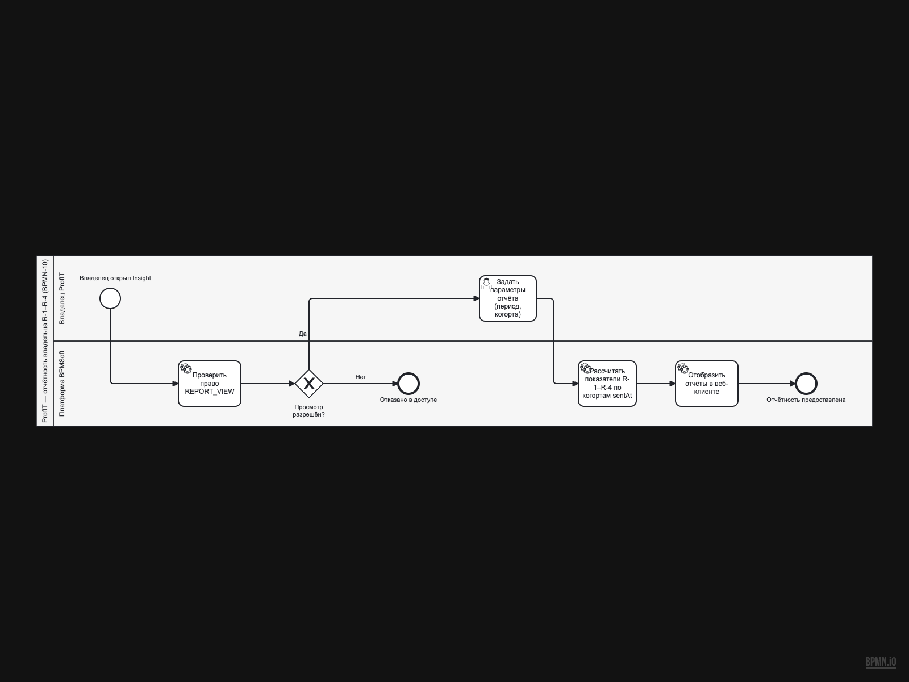
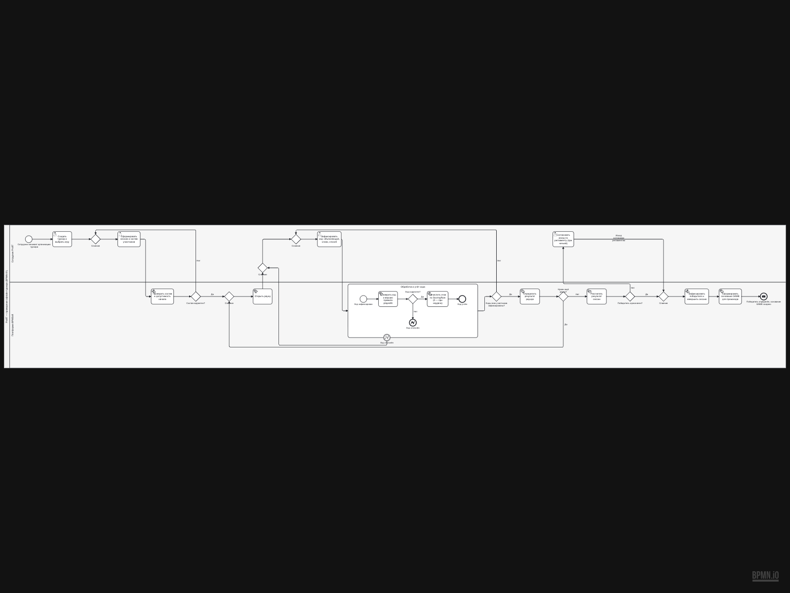

# BPMN — исправления по отзыву (команда 1, драфт 1)

Источник замечаний: `Отзыв_BPMN_команда_1_драфт1.docx`.
Ниже — каждое замечание, диагноз, что изменено и в каких файлах. Порядок соответствует очерёдности исправления.

## П.1–2. Таймер на каждый промокод и двойная аннуляция (BPMN-05 против API №4)

**Замечание:** BPMN-05 моделировал `deliveryDeadlineAt`/окно доставки таймером на экземпляр процесса — это противоречит решению ПР-4 (периодический опрос БД планировщиком, а не сообщение-таймер на каждый код). Аннуляция `DISPATCH_TIMEOUT` существовала дважды: в BPMN-05 и в BPMN-07 → гонка/двойная запись.

**Исправлено в `ProfIT_BPMN_05.bpmn`:**
- удалены `T_OUT` (timer «Истёк deliveryDeadlineAt») → `ST9` («Аннулировать ANNULLED/DISPATCH_TIMEOUT») → `E4`, потоки `flow_8/27/28`;
- удалены `T_WIN` (timer «Окно ожидания доставки истекло») → `ST6`, потоки `flow_14/19/20`;
- удалён вырожденный шлюз `J_X`; `ST5` теперь напрямую ведёт в `E3`;
- `GEV1` и `GEV2` сохранили по 2 исходящих потока (оба — message catch) — правило event-based шлюза соблюдено;
- пустая нижняя полоса дорожки убрана, пул сжат по высоте (750→600px);
- `S1` стал Message Start (основание GAME/TEST от BPMN-01/03), `E1`/`E3` — Message End (готов к активации → BPMN-06).

**Итог:** в BPMN-05 нет ни одного таймера на код; переход `ANNULLED / DISPATCH_TIMEOUT` существует только в BPMN-07 (плановая проверка `deliveryDeadlineAt`, ветка `S_A`).

## П.3.1. Обзорная диаграмма BPMN-00

**Замечание:** нет карты комплекта — непонятно, как процессы связаны.

**Исправлено — новый файл `ProfIT_BPMN_00.bpmn`:**
- каждый детальный процесс — Call Activity (`calledElement` → `Process_ProfIT_BPMN_NN`);
- внешние участники отдельными пулами: публичный пользователь, владелец, внешняя торговая система, почтовый провайдер, сотрудник ProfIT;
- 11 Message Flow: участие/прохождение теста (пользователь), письмо и статусы (провайдер), проверка/покупка и пакет продаж (ТС), запрос отчётов, ручная отмена и администрирование (владелец), запуск турнира и ведение каталога (сотрудник);
- все 5 стартовых событий типизированы: 4 Message Start + 1 Timer Start (плановая проверка сроков) — каждый message-старт получает реальный `messageFlow` от своего инициатора;
- имена стартов согласованы с детальными диаграммами (напр., каталог — «Запрос на создание или изменение карточки» как в BPMN-04);
- цепочка процессов прочитана слева направо: 01/03 → 05 → 06 → 08, плюс сервисные процессы 02, 04, 07, 09, 10.

## П.3.2. Явные связи между процессами

**Замечание:** связь процессов не выражена на диаграммах.

**Исправлено (события-сообщения на стыках):**

| Связь | Реализация |
|---|---|
| BPMN-01 → BPMN-05 | `E1` в 01 — Message End «основание GAME создано»; `S1` в 05 — Message Start «Подтверждено основание GAME / TEST» |
| BPMN-03 → BPMN-05 | основание TEST создаётся `ST6` в 03; тот же Message Start `S1` в 05 |
| BPMN-05 → BPMN-06 | `E1`/`E3` в 05 — Message End «готов к активации»; запуск проверки в 06 — Message Start `S1` |
| BPMN-06 → BPMN-08 | `E1` в 06 — Message End «Покупка учтена, код активирован»; `S_A` в 08 — Message Start «Пакет продаж» (messageFlow от пула ТС уже существовал) |
| BPMN-08 → BPMN-10 | `E_A2` в 08 — Message End «Продажи учтены → BPMN-10» (публикация данных для отчётного контура) |

## П.4.1. Независимые процессы в одной диаграмме

**Замечание:** BPMN-08 совмещал независимые импорт продаж и отчётность; BPMN-07 и BPMN-09 — группы направлений без оговорки.

**Исправлено:**
- `ProfIT_BPMN_08.bpmn` — только импорт продаж (7 узлов, Message Start от ТС);
- новый `ProfIT_BPMN_10.bpmn` — отчётность владельца R-1–R-4 (8 узлов);
- в отчёте для BPMN-07 и BPMN-09 явно зафиксировано «группа связанных процессов в одной схеме» с обоснованием общего контура.

## П.4.2. Открытые вопросы разбросаны

**Исправлено:** в отчёте добавлен сводный раздел «Открытые вопросы к реализации» — таблица В-1…В-9 (лимит раундов, критерий победителя и ничья, политика ретраев, периодичность проверок сроков, окно подтверждения покупки, зачёт частичной попытки, поля пакета продаж, состав R-1–R-4, `ACCOUNT_DEACTIVATE`) с указанием места возникновения и владельца решения.

## П.4.3. Ничья в BPMN-01 без явного исхода

**Замечание:** `T4 «Согласовать исход по регламенту»` → `J5` продолжал процесс без показанного решения.

**Исправлено в `ProfIT_BPMN_01.bpmn`:** исход задачи назван явно — `flow_21` получил имя «Исход согласован регламентом». User Task с владельцем (регламент) теперь имеет подтверждающий исход; продолжение возможно только после решения. Согласование срока и критерия оставлено в открытых вопросах В-1/В-2.

## П.4.4. Границы BPMN-09

**Замечание:** неясно, что ценность не в штатных операциях.

**Исправлено в отчёте:** назначение роли и деактивация — штатные операции платформы BPMSoft; моделируемая ценность — проверки сеанса, прав `OWNER`/`ACCOUNT_DEACTIVATE` и матрицы разрешений вокруг них. Текст раздела «Реализация в BPMN и BPMSoft» уточнён, «не следует утверждать, что собственный IAM реализован» сохранено в уточнениях.

## Финальные правки после ревью в редакторе

- Все стартовые события BPMN-00 типизированы (устранён lint-дефект «multiple blank start events»); добавлен пул «Сотрудник ProfIT» и сообщения-инициаторы к каждому message-старту.
- Ручная раскладка в `ProfIT_BPMN_05.bpmn`, `ProfIT_BPMN_06.bpmn`, `ProfIT_BPMN_09.bpmn`, `ProfIT_BPMN_00.bpmn` (выпрямление маршрутов, переупорядочивание элементов) — принята и перерендерена.
- Слияния-шлюзы оставлены безымянными по решению команды.

## Проверки после исправлений

- `xmllint --noout` — все 11 файлов валидны;
- `scripts/bpmn/check_files.mjs` — ни одного висячего `sourceRef/targetRef`, у всех Event-Based Gateway ≥2 исходящих, ни одна стрелка не проходит сквозь блок (11/11 OK);
- рендер bpmn-js (`scripts/bpmn/render.mjs`) — все изменённые файлы импортируются и отрисовываются;
- `typst compile` — отчёт собран без ошибок, PDF обновлён;
- статистика элементов в отчёте пересчитана по фактическому XML.

## Файлы

Диаграммы: `ProfIT_BPMN_00.bpmn` … `ProfIT_BPMN_10.bpmn` (BPMN 2.0 XML + BPMNDI, редактируемые).
Рендеры: `../ProfIT_BPMN_XX.svg`, скриншоты — `screenshots/`.
Отчёт: `../profit-bpmn-practice5.typ` → `../profit-bpmn-practice5.pdf`.

### Чем открывать в VS Code
- **BPMN.io Editor** (`bpmn-io.vs-code-bpmn-io`) — рекомендуется, файлы генерировались под bpmn-js;
- **BPMN Modeler** (`miragon-gmbh.vs-code-bpmn-modeler`);
- **BPMN Editor** (`redhat.vscode-extension-bpmn-editor`);
- **Open-BPMN** (`open-bpmn.open-bpmn-vscode-extension`, требует Java 17+).

> Если редактор показывает устаревшую диагностику по файлу, изменённому снаружи: закройте вкладку без сохранения и откройте заново (Revert File) — иначе старый буфер перезапишет файл на диске.
